# BlogSpace – Blog Management Frontend (Next.js)

A complete frontend for the Blog REST API. Guests can browse, search and filter blogs; users can register, log in, manage their profile and blogs; admins can additionally manage users and every blog. **All data comes from the REST API** – there is no mock data, hardcoded users or frontend-only auth.

## Main features
- Public homepage with blog cards, debounced search (`?title=`), category filter (`?category=`) and combined search + category
- Blog details page with a "Blog Not Found" state
- Register, Login, Forgot Password, Reset Password
- Persistent auth (token in `localStorage`, profile reloaded on refresh), auto-logout on any 401
- Protected dashboard routes and an admin-only area (Access Denied for normal users; backend 401/403 responses are respected)
- Dashboard (welcome, blog count, profile card, recent blogs, quick create)
- Blog create / edit / delete with confirmation dialog (`userId` is never sent)
- Profile edit, profile image upload (`multipart/form-data`, field `image`) with instant Navbar avatar update, change password
- Admin: user list, user details, activate/deactivate, all blogs (edit/delete any)
- Loading skeletons/spinners, pending buttons, empty states, toast notifications, friendly error messages
- Responsive: sidebar becomes a drawer on mobile, cards stack, forms fit the viewport

## Technologies
Next.js 14 (App Router) · React 18 · Tailwind CSS 3 · Fetch API

## Installation
```bash
npm install
cp .env.example .env.local   # then edit the value if needed
npm run dev                  # http://localhost:3000
```
Production: `npm run build && npm start`

## Environment variables
| Name | Example | Description |
|------|---------|-------------|
| `NEXT_PUBLIC_API_URL` | `http://localhost:5000/api` | Base URL of the Blog REST API (including `/api`) |

Never commit your real `.env` / `.env.local`.

## Backend dependency
This frontend needs the **Blog REST API**, which lives in a separate repository:
**https://github.com/adnanasif12/api-development**

Run the backend first (requires Node.js and MySQL):
```bash
git clone https://github.com/adnanasif12/api-development.git
cd api-development
npm install
cp .env.example .env     # set DB_PASSWORD, JWT_SECRET (and optionally SMTP_*)
npm run dev              # http://localhost:5000
npm run seed:admin       # optional: creates an admin user (see scripts/seedAdmin.js)
```
Then start this frontend (see Installation). The API must be reachable at `NEXT_PUBLIC_API_URL` (default `http://localhost:5000/api`).

The backend provides every endpoint used here, including forgot/reset password and profile-image upload. Set `FRONTEND_URL` in its `.env` (default `http://localhost:3000`) so reset links point to this app. Without SMTP settings, the reset link is printed in the backend console instead of being emailed. Uploaded avatars are served from `http://localhost:5000/uploads/...`.

### Password policy
New passwords (Register, Reset Password, Change Password) must have **8-64 characters, an uppercase letter, a lowercase letter, a number and a special character**, with no spaces. The form shows a live strength meter and checklist. The same rules are enforced by the backend (`passwordProblems` in `src/validators/helpers.js`), so they cannot be bypassed from the UI. Login does not apply the policy, so accounts created earlier with weaker passwords can still sign in.

### Email (SMTP) for password reset
In the backend's `.env` set `SMTP_HOST`, `SMTP_PORT`, `SMTP_USER`, `SMTP_PASS` and `MAIL_FROM`. For Gmail, enable 2-Step Verification and create an **App Password** (Google Account > Security > App passwords); use it as `SMTP_PASS`. Restart the backend afterwards. If SMTP is not configured (or sending fails) the reset link is printed in the backend console.

Field names follow the backend: `firstname`/`lastname` for users and `createAt` for timestamps.

## Routes
| Route | Access |
|-------|--------|
| `/` | Public |
| `/blogs/[id]` | Public |
| `/login`, `/register`, `/forgot-password`, `/reset-password/[token]` | Public |
| `/dashboard` | User / Admin |
| `/dashboard/blogs` (My Blogs / All Blogs) | User / Admin |
| `/dashboard/blogs/create` | User / Admin |
| `/dashboard/blogs/[id]/edit` | Owner / Admin |
| `/dashboard/profile` | User / Admin |
| `/dashboard/change-password` | User / Admin |
| `/admin/users` | Admin |

## User vs Admin
- **User** – manage own profile and password, create blogs, edit/delete only own blogs.
- **Admin** – everything above, plus the **Users** page (view, activate, deactivate) and edit/delete of any blog. Authorization is enforced by the backend; the UI only mirrors it.

## Project structure
```
app/          routes (App Router)
components/   Navbar, Sidebar, ProfileMenu, BlogCard, BlogForm, SearchBar, CategoryFilter, Loader, ConfirmDialog, ...
contexts/     AuthContext (auth state), ToastContext
services/     auth.service.js, user.service.js, blog.service.js
utils/        api.js (fetch wrapper), auth.js, format.js, validators.js
```

## Notes on API response shapes
`utils/api.js` (`pickList` / `pickObject`) and `utils/format.js` tolerate common response shapes (`{ blogs: [] }`, `{ data: [] }`, `{ user: {} }`, …) and field names (`blogTitle`/`title`, `profileImage`/`image`). If your backend uses different names, adjust them in those two files only.

"My Blogs" is built by filtering `GET /api/blogs` by the logged-in author's id, so the API must return the author (populated `user`/`author` object or id) on each blog.

## Screenshots

### Public (guest)
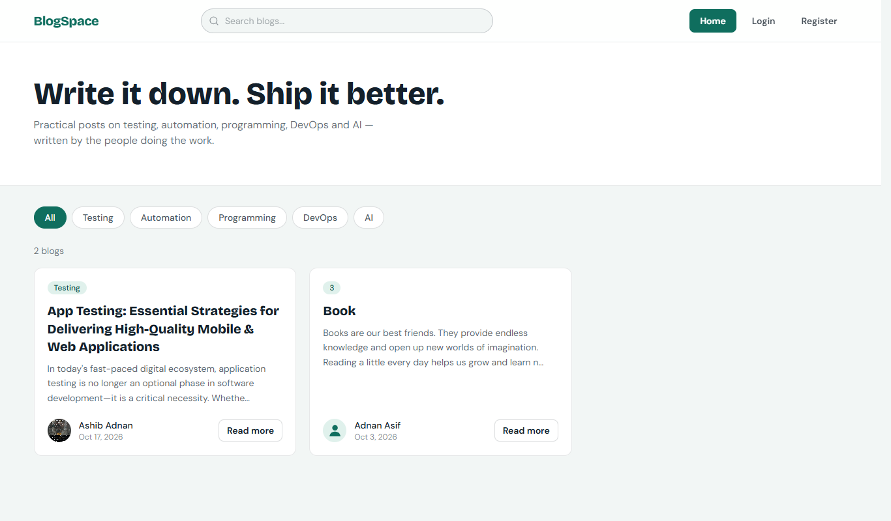

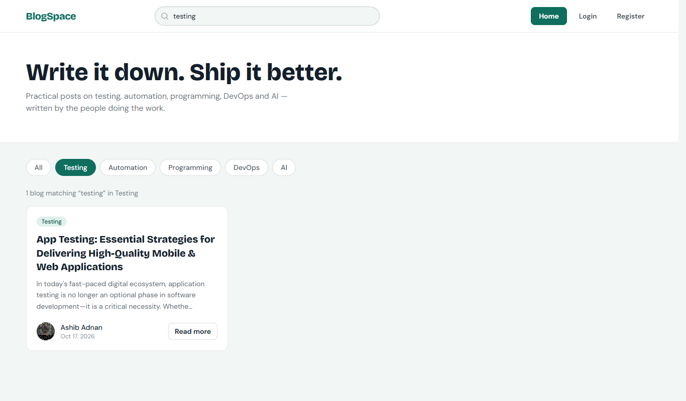

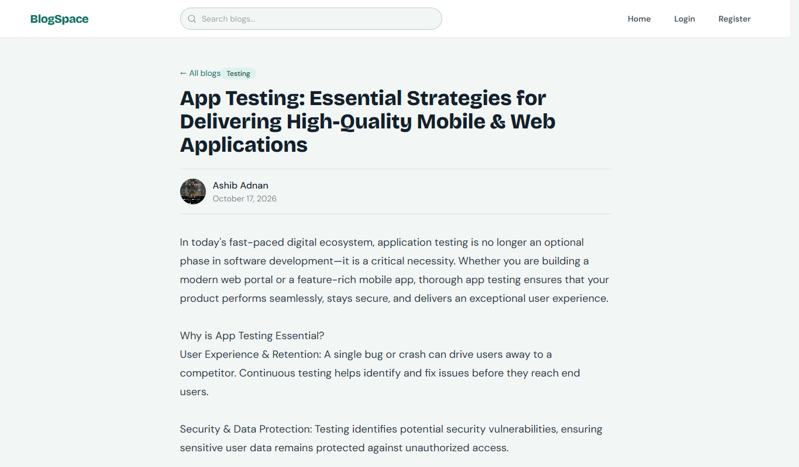

| Login | Register | Forgot password |
|-------|----------|-----------------|
| 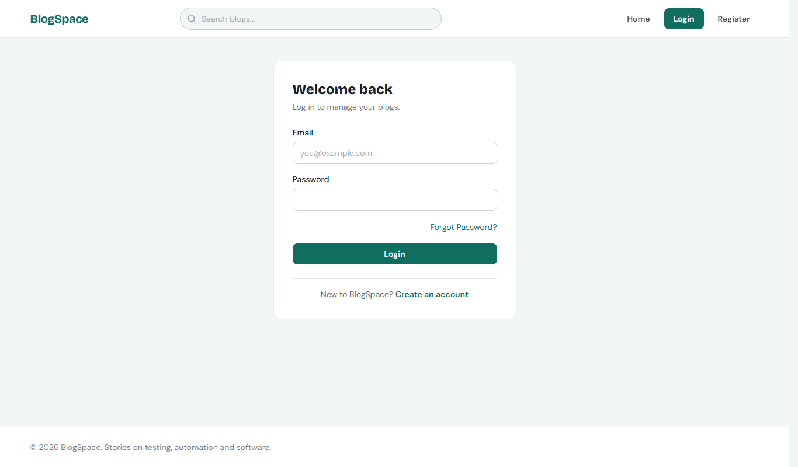 | 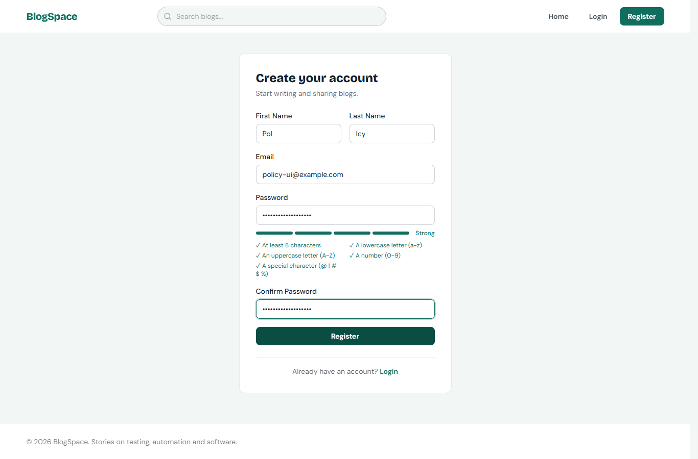 | 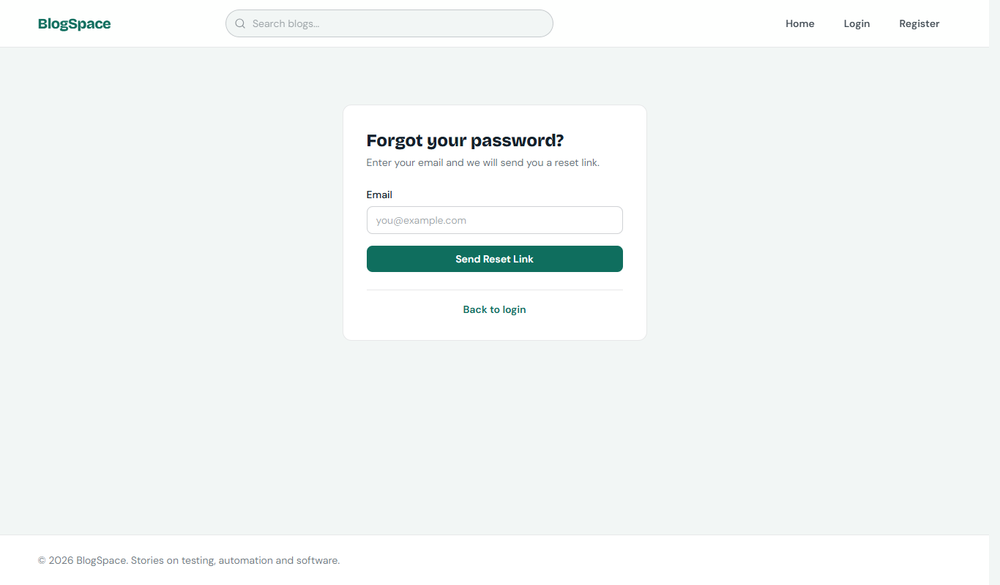 |

### Dashboard (user / admin)
**Dashboard**
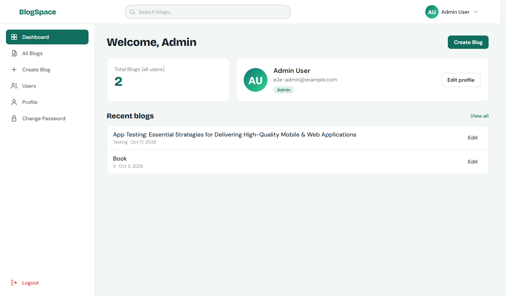

**My Blogs / All Blogs**
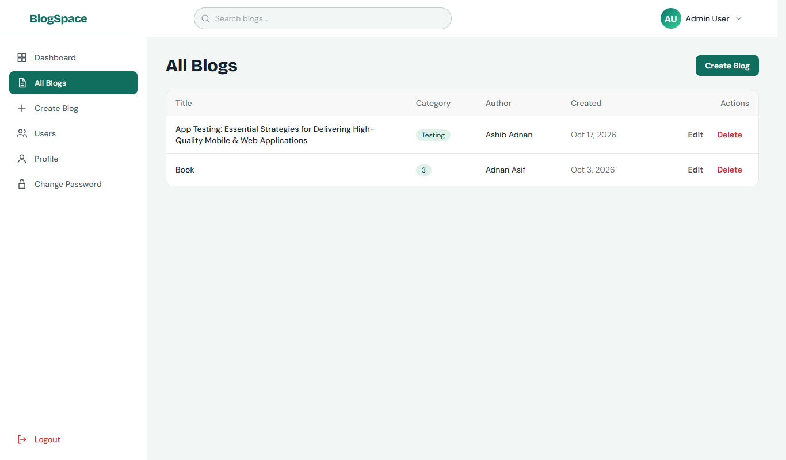

**Create blog**
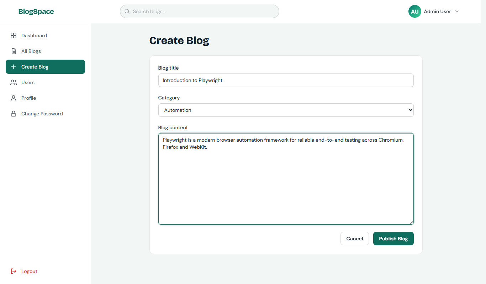

**Delete confirmation**
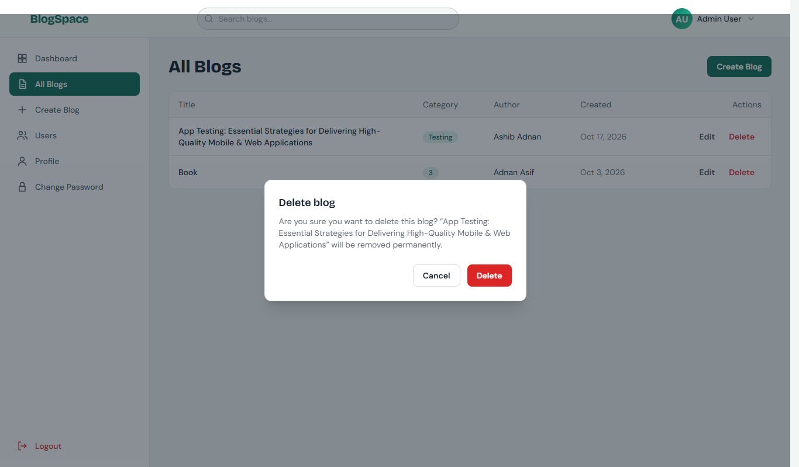

**Profile (avatar upload + edit name)**
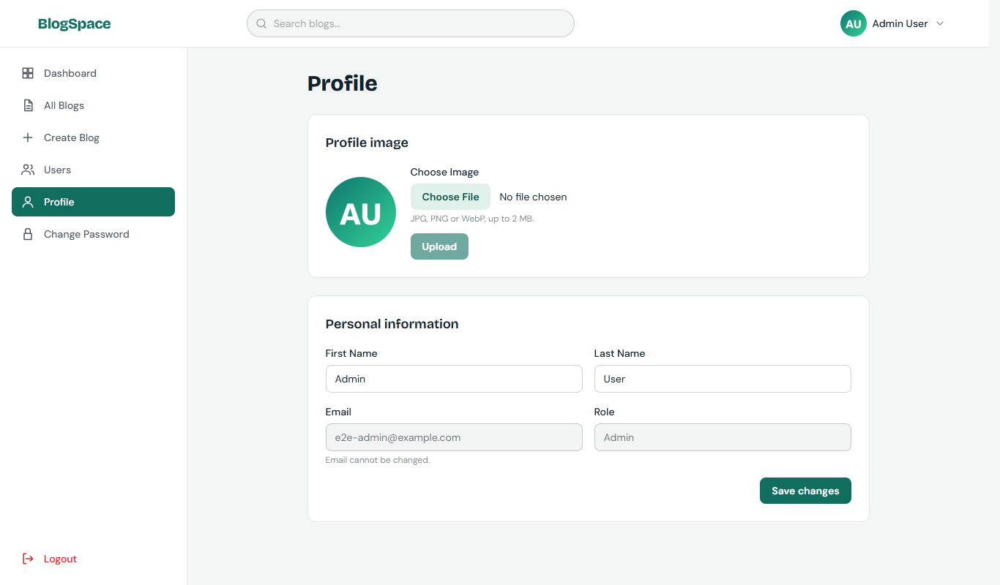

**Change password**
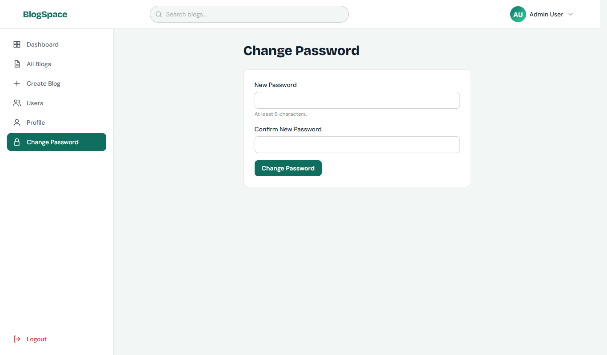

### Admin
**User management**
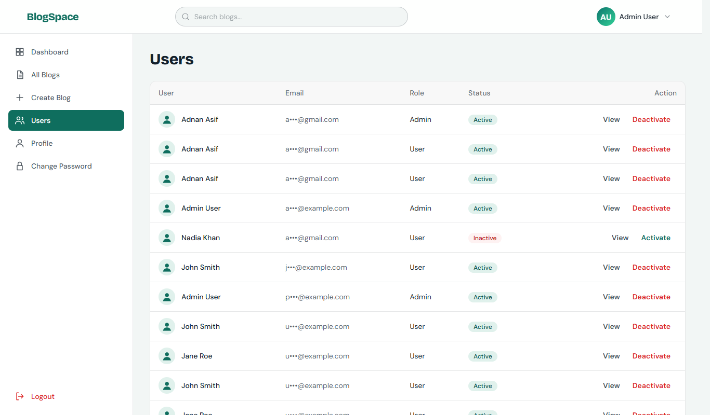

**User details**
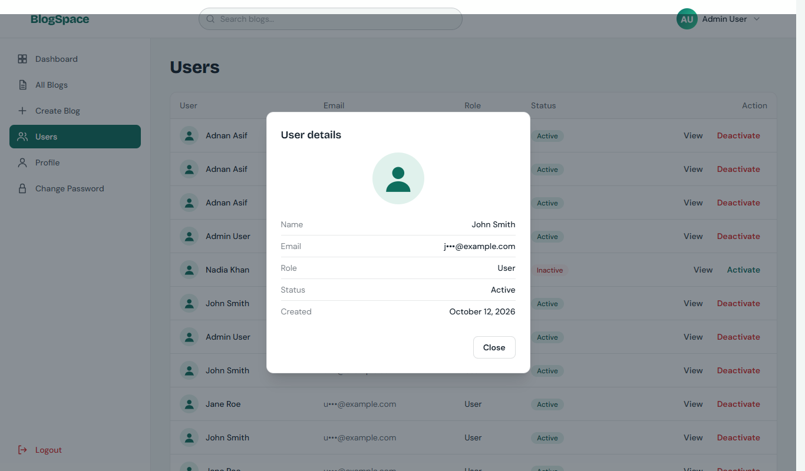

### Responsive
| Tablet (768px) | Tablet drawer | Mobile (390px) | Mobile drawer |
|----------------|---------------|----------------|---------------|
| 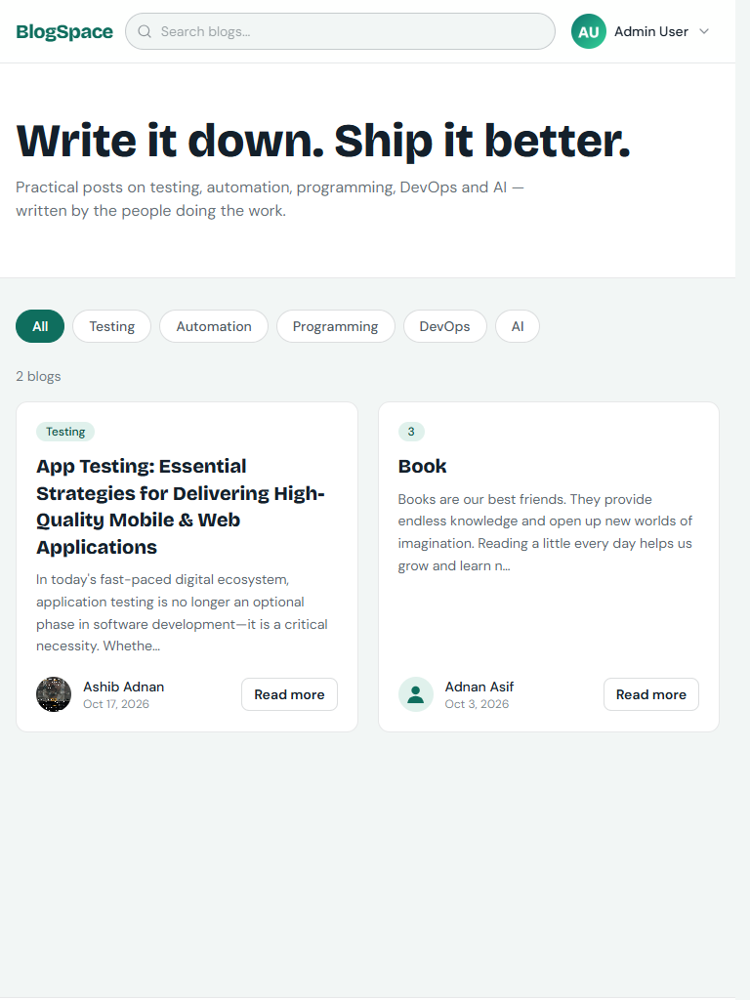 | 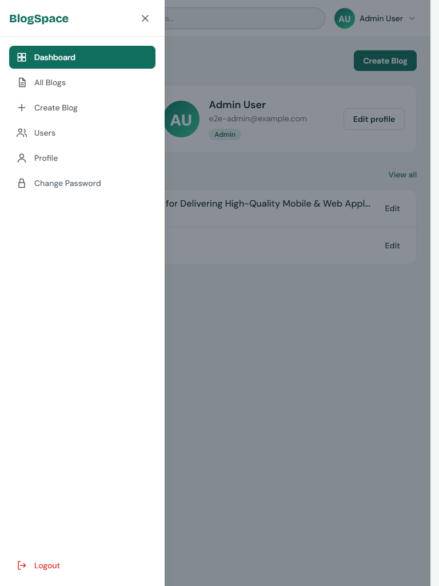 | 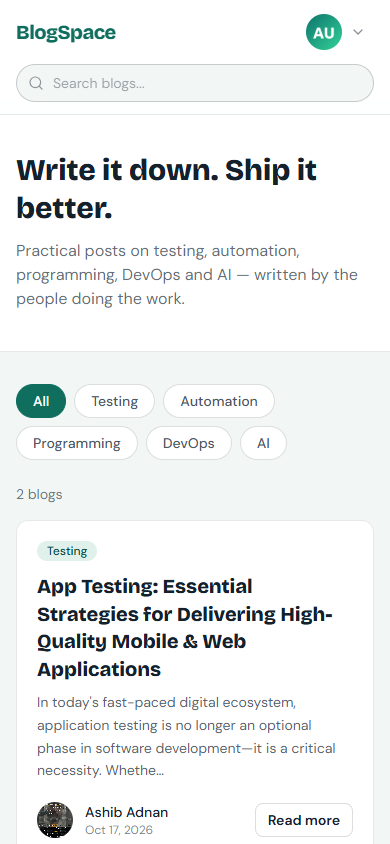 | 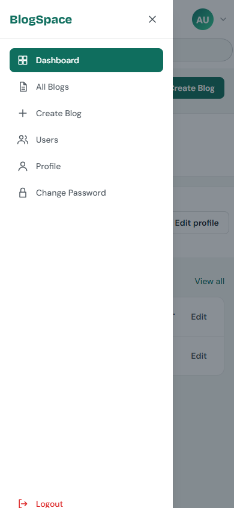 |
